# 일산지 거리 — 시티즈: 스카이라인 2 인게임 배치 키트

울산 동구 **일산해수욕장 앞 해변 상가 거리**를 시티즈2 안에 옮기기 위한 키트입니다.

| 구성 | 위치 | 내용 |
|---|---|---|
| **실측 맵** | `Heightmaps/` | 일산지 거리를 중심으로 한 실제 지형 하이트맵(14.336 km)과 월드맵(57.344 km), 하천 물길 포함 |
| **에셋 34종** | `CS2Assets/` | 건물 25 (해변 상가 · 타니베이호텔 · **실제 브랜드 매장**(스타벅스 DT · 테라스파크 · 홈플러스 · GS25 · CU) · 모퉁이 유리 상가 · 청년스테이지ON …), 광장 · 해변 시설 4, 소품 5. 8 m 셀 부지, 텍스처 5종, LOD 3단계 |
| **배치표** | `Heightmaps/Ilsan_Placement.md` | 부지 48곳(해변 도로 29 · 청년광장 14 · 방어진순환도로 건너편 1 · 바다 쪽 4)과 소품 127개(해송 61 · 난간 63 · 회전교차로 · 노면 글자 2)의 게임 좌표 · 회전 · 높이 |

## 사진 6장 재현

보내 주신 일산지 사진 6장과 같은 자리 · 같은 방향에서, **하이트맵 + 배치표 + 내보낸 FBX 만으로** 다시 조립한 장면을 찍었습니다
(`preview_layout.py --photos docs`).

| 사진 | 키트에서 같은 구도 | 무엇으로 만들었나 |
|---|---|---|
| ① 일산지 중심 상가 건물 (도로변 상업시설) | 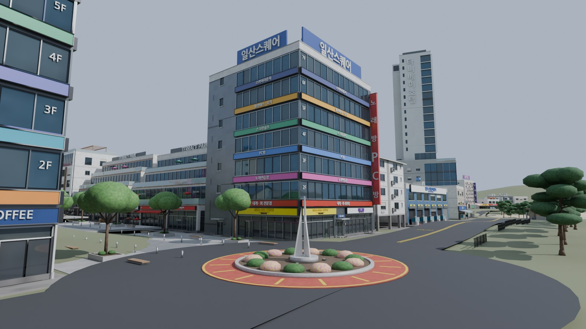 | 회전교차로 중앙섬(붉은 화물차 턱 · 노란 띠 · 흰 돛 조형물) + 광장 모퉁이 7층 유리 상가 `IlsanCornerTower01/02` (층마다 업종 간판 띠, 세로 간판, 옥상 ㄱ자 간판) |
| ② 일산지 상가 거리 (해변 진입로 주변) | 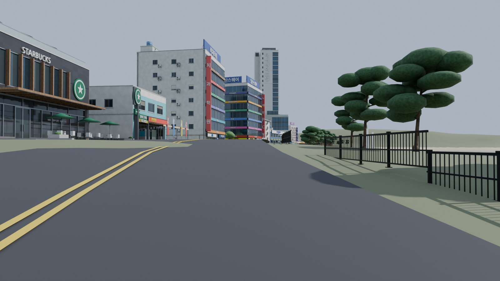 | 노란 중앙선 도로, 바다 쪽 검은 난간 `IlsanBeachRail`, 해송 `IlsanPine01/02`, 깃발 늘어선 원색 횟집 `IlsanHoetjip03`, 노면 글자 `CCTV 주차단속` |
| ③ 일산지 항공 전경 | 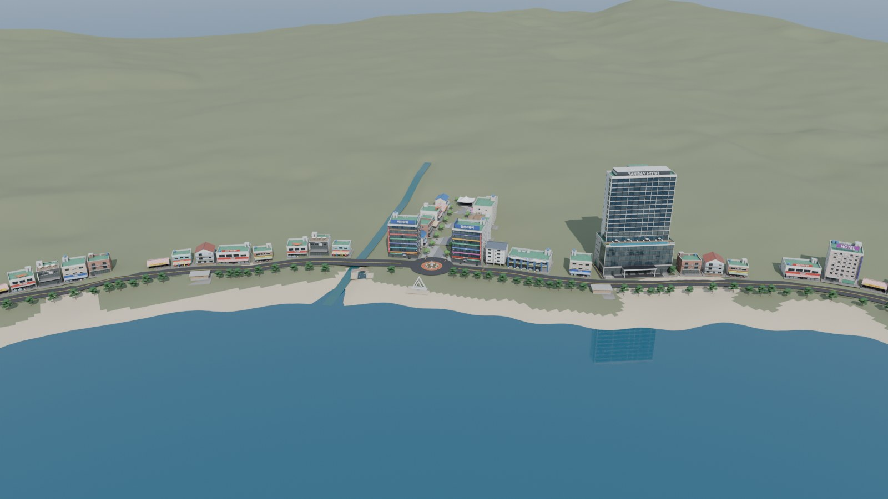 | 실측 지형 · 해안선 위에 거리 전체 배치 |
| ④ 타니베이호텔 | 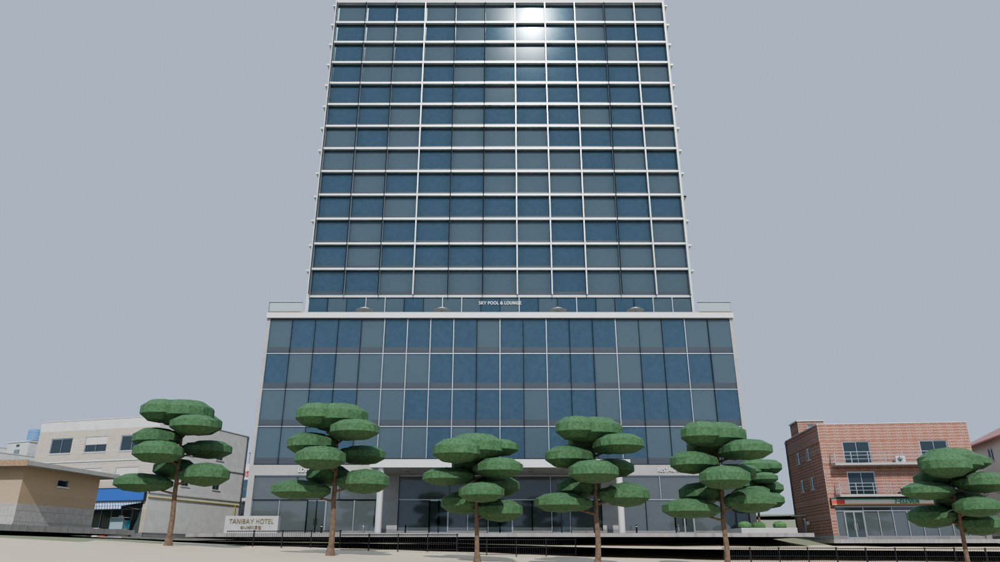 | 19층 `IlsanTanibayHotel` — 유리 커튼월 저층부(1~5층), 6층 인피니티 풀 데크, 흰 세로 핀 객실 탑, 백사장 해송 |
| ⑤ 일산지 청년광장 주변 | 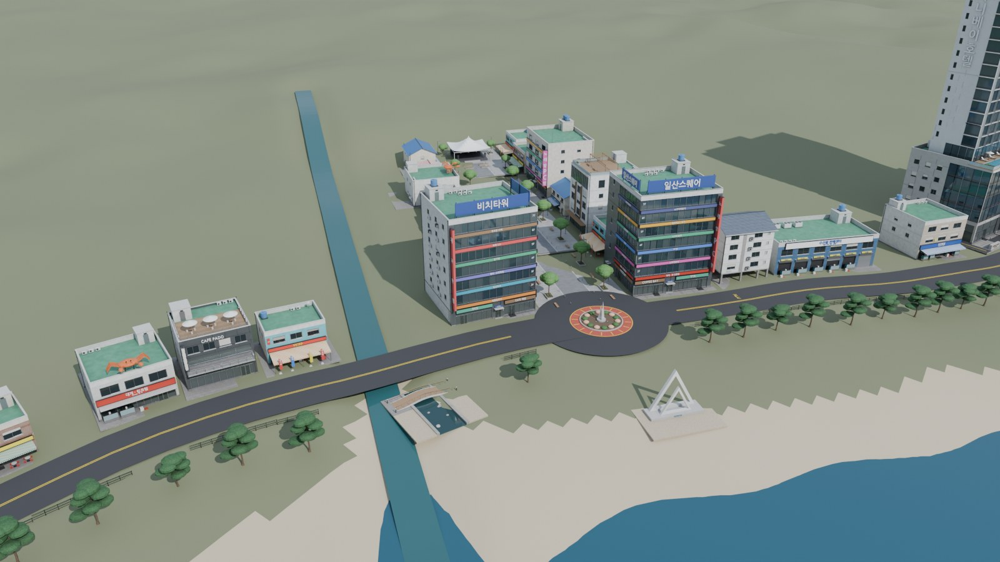 | 해변으로 이어지는 광장, 백사장 흰 삼각 조형물, 하천 하구와 보행교, 붉은 원형 회전교차로, 흰 천막 |
| ⑥ 일산지 거리 전경 (상가 밀집 지역) | 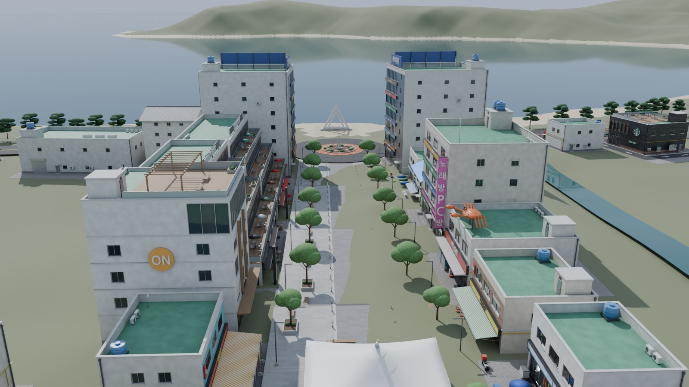 | 광장 끝 버스킹 무대와 막 구조 천막, 양옆 상가, 파란 지붕 `IlsanBlueRoof01`, 청년스테이지ON |

## 실제 브랜드 매장

일산해수욕장 주변에 실제로 있는 브랜드 매장을 찾아 그 자리에 맞춰 만들었습니다 (검색으로 확인한 정보 기준).

| 매장 | 키트에서 | 실제 정보 | 만든 것 |
|---|---|---|---|
| **테라스파크** (A · C동) | 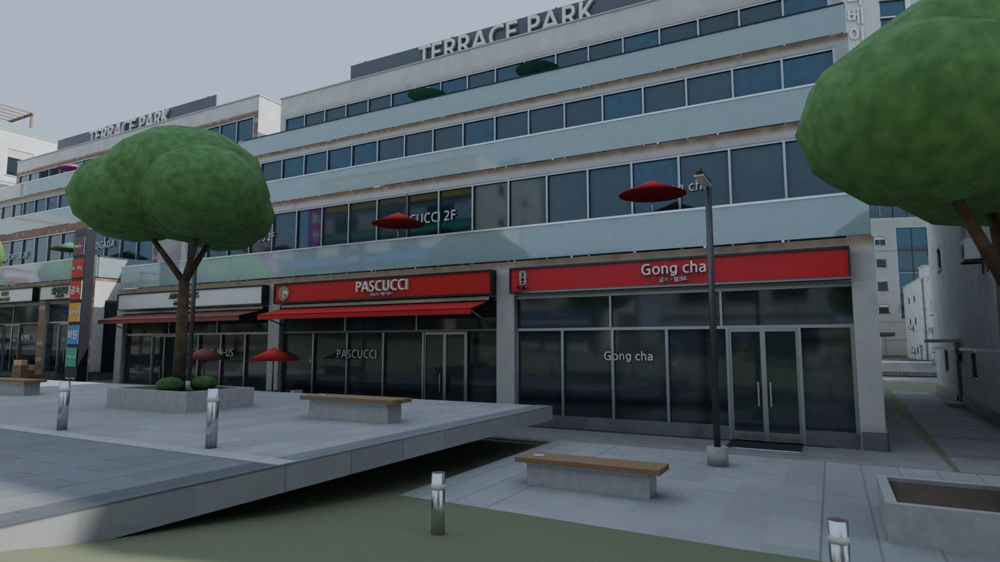 | 방어진순환도로 652 (일산동 945), 2011년 준공, 지하 1층 · 지상 4층 5개 동 '스트리트형 상가', 일산해수욕장 바로 앞. 1층 엔제리너스 · 파스쿠치 · 공차 · 봉구비어 · 드롭탑 · 오가다 · 꽃집 | 층마다 3 m 물러나는 4층 계단형 테라스(데크 · 유리 난간 · 파라솔 · 화분 · 벤치), 1층 브랜드 간판 · 차양 · 테라스 테이블, 2층 카페 좌석 유리 글자, 3 · 4층 학원 · 운동 · 병원 간판, 세로 상가 안내 기둥, 옥상 TERRACE PARK 글자 |
| **스타벅스 울산일산비치DT점** | 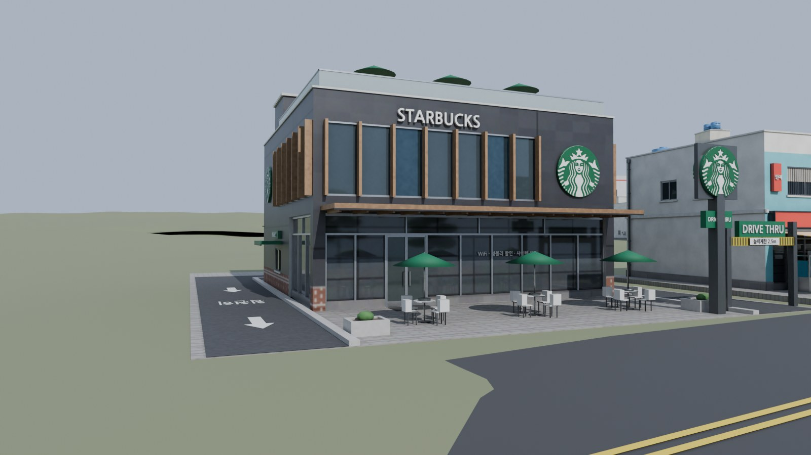 | 일산진11길 95, 드라이브스루 · 루프탑 | 건물을 시계 반대로 감싸는 DT 차로(들어오는 차로 높이 제한 문 → 뒤 메뉴판 · 스피커 → 왼쪽 면 픽업 창, 운전석 쪽), 바닥 화살표 · 'DRIVE THRU' 노면 글자, 원형 엠블럼 3면 + 기둥 간판, 목재 루버 캐노피 · 세로 목재 핀, 루프탑 파라솔 테라스 |
| **홈플러스 울산동구점** | 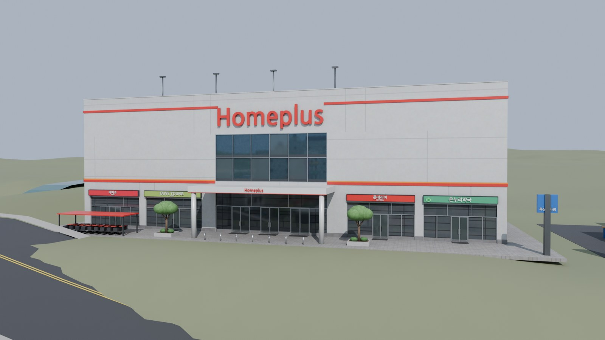 | 방어진순환도로 637 (일산동), 테라스파크 맞은편 | 유리 아트리움 정문 + Homeplus 캐노피, 큰 Homeplus 글자(정면 · 옆), 빨강 · 주황 띠, 1층 임대 매장 간판, 카트 보관대, 옥상 주차장(주차선 · 화살표 · 조명 기둥 · 경사로 하우스 · 유리 엘리베이터 로비), 진입 · 진출 경사로 입구, 뒤 하역장 |
| **GS25 · CU** | 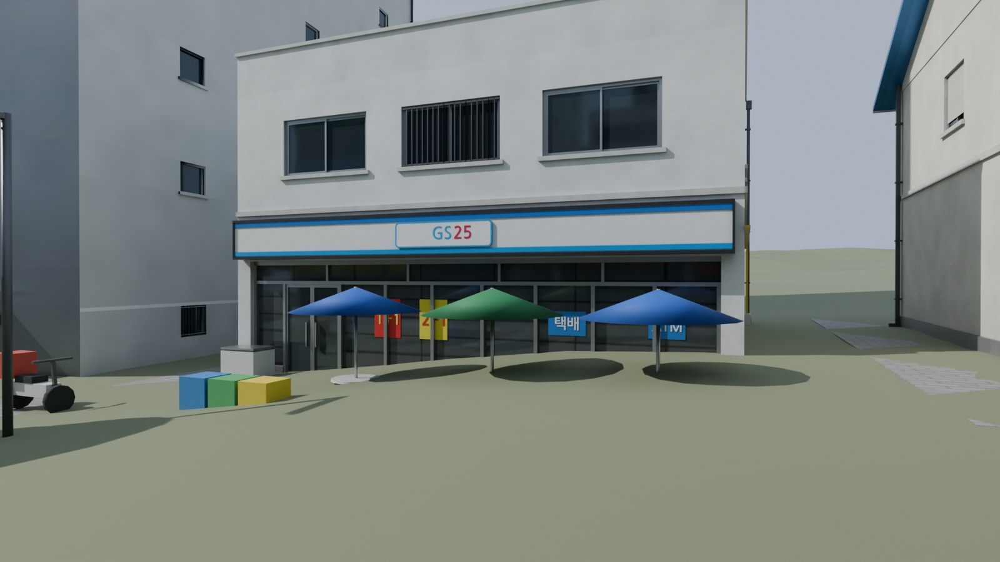 | 해변 상가에 흔한 편의점 (정확한 지점 위치는 확인하지 못함) | 브랜드 색 간판, 유리 안쪽 1+1 · 2+1 · 택배 · ATM 포스터, 맥주 브랜드 색 파라솔 테이블, 아이스크림 냉장고, 분리수거함, 배달 오토바이, ATM 부스(CU), 옥상 태양광(CU) |

기존 건물 간판도 실제 브랜드로 바꿨습니다: 회전교차로 모퉁이 상가 1층 **CU · 메가MGC커피 / GS25 · 이디야커피**, 편의점 → **세븐일레븐**,
근린상가 분식 → **김밥천국**, 치킨 · 호프 → **교촌치킨**.

> 간판은 상표 그림(로고 이미지)이 아니라 **브랜드 색 + 글자**로 만든 근사치입니다 (스타벅스는 초록 원 + 흰 고리 + 별).
> 개인 플레이용으로는 문제없지만, Paradox Mods 등에 공개 배포할 때는 상표 사용 규정을 확인하세요.
> 매장 외관 세부는 사진이 없어 각 브랜드 매장의 흔한 모습으로 추정했고, 홈플러스 1층 임대 매장 구성은 예시입니다.

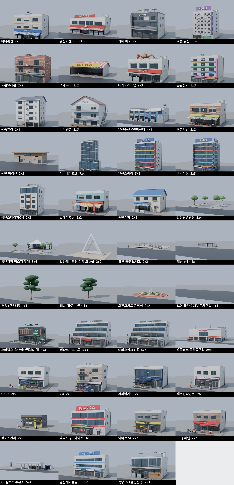

<!-- ASSET_TABLE -->
| 에셋 | 간판 | 종류 | 부지 (셀) | 건물 크기 | 높이 | 삼각형 LOD0 / 1 / 2 | 개구부 | 텍스처 |
|---|---|---|---|---|---|---|---|---|
| `IlsanHoetjip01` | 바다횟집 | 횟집 | 2×3 | 15.2 × 15.0 m | 15.35 m | 16,543 / 8,629 / 1,868 | 22 | 2048 |
| `IlsanHoetjip02` | 동해회센터 | 횟집 | 3×3 | 23.0 × 14.5 m | 11.15 m | 20,305 / 9,292 / 1,516 | 16 | 2048 |
| `IlsanCafe01` | 카페 파도 | 카페 | 2×3 | 14.0 × 14.0 m | 14.35 m | 12,300 / 7,744 / 1,984 | 25 | 2048 |
| `IlsanMotel01` | 호텔 일산 | 숙박 | 3×4 | 20.0 × 18.0 m | 28.2 m | 33,131 / 23,576 / 6,018 | 96 | 2048 |
| `IlsanShop01` | 편의점 | 상가 | 2×2 | 14.0 × 12.0 m | 12.95 m | 10,047 / 6,387 / 1,612 | 20 | 2048 |
| `IlsanGrill01` | 조개구이 | 조개구이 | 2×2 | 14.0 × 11.0 m | 5.7 m | 6,239 / 2,727 / 106 | 0 | 1024 |
| `IlsanCrab01` | 대게 · 킹크랩 | 대게 | 2×3 | 15.0 × 15.0 m | 11.06 m | 12,746 / 6,851 / 2,270 | 13 | 2048 |
| `IlsanMixed01` | 근린상가 | 근린상가 | 3×3 | 22.0 × 16.0 m | 23.15 m | 36,331 / 16,353 / 3,462 | 47 | 2048 |
| `IlsanVilla01` | 해송빌라 | 주거 | 2×3 | 14.0 × 13.0 m | 17.23 m | 10,955 / 8,446 / 2,350 | 40 | 2048 |
| `IlsanPension01` | 바다펜션 | 펜션 | 2×3 | 12.5 × 12.0 m | 12.83 m | 6,800 / 4,959 / 1,664 | 22 | 2048 |
| `IlsanMarket01` | 수산물 판매센터 | 시장 | 4×3 | 30.0 × 16.0 m | 13.65 m | 31,109 / 13,288 / 1,832 | 27 | 2048 |
| `IlsanChicken01` | 치킨 · 호프 | 치킨 | 2×2 | 13.5 × 10.5 m | 10.25 m | 15,396 / 6,540 / 1,370 | 13 | 2048 |
| `IlsanToilet01` | 해변 화장실 | 화장실 | 2×2 | 12.0 × 7.0 m | 4.0 m | 5,563 / 2,354 / 364 | 6 | 1024 |
| `IlsanTanibayHotel` | 타니베이호텔 | 호텔 | 7×4 | 50.0 × 24.0 m | 79.35 m | 64,788 / 39,690 / 13,247 | 242 | 4096 |
| `IlsanCornerTower01` | 일산스퀘어 | 상업빌딩 | 3×3 | 22.0 × 20.0 m | 31.35 m | 77,158 / 30,342 / 3,284 | 63 | 2048 |
| `IlsanCornerTower02` | 비치타워 | 상업빌딩 | 3×3 | 22.0 × 20.0 m | 31.35 m | 74,573 / 29,648 / 3,284 | 63 | 2048 |
| `IlsanYouthStage` | 청년스테이지ON | 청년공간 | 2×3 | 14.0 × 17.0 m | 22.42 m | 13,607 / 9,872 / 3,184 | 42 | 2048 |
| `IlsanHoetjip03` | 갈매기횟집 | 횟집 | 2×2 | 13.0 × 10.0 m | 9.1 m | 22,697 / 9,025 / 1,466 | 13 | 2048 |
| `IlsanBlueRoof01` | 해변슈퍼 | 상가 | 2×2 | 12.0 × 9.5 m | 9.23 m | 5,241 / 3,172 / 930 | 12 | 2048 |
| `IlsanPlaza01` | 일산청년광장 | 광장 | 3×4 | 24.0 × 32.0 m | 7.22 m | 5,642 / 4,866 / 4,098 | 0 | 2048 |
| `IlsanPlazaStage` | 청년광장 버스킹 무대 | 광장 | 3×4 | 24.0 × 32.0 m | 8.9 m | 17,394 / 8,862 / 4,970 | 0 | 2048 |
| `IlsanBeachLandmark` | 일산해수욕장 삼각 조형물 | 조형물 | 2×2 | 16.0 × 16.0 m | 9.65 m | 6,496 / 1,996 / 80 | 0 | 1024 |
| `IlsanStreamBridge` | 하천 하구 보행교 | 다리 | 2×2 | 16.0 × 16.0 m | 2.13 m | 2,062 / 1,802 / 1,218 | 0 | 1024 |
| `IlsanBeachRail` | 해변 난간 | 소품 | 1×1 | 8.0 × 8.0 m | 1.14 m | 792 / 792 / 792 | 0 | 512 |
| `IlsanPine01` | 해송 (큰 나무) | 조경 | 1×1 | 8.0 × 8.0 m | 8.46 m | 2,172 / 2,172 / 2,172 | 0 | 1024 |
| `IlsanPine02` | 해송 (굽은 나무) | 조경 | 1×1 | 8.0 × 8.0 m | 7.02 m | 2,172 / 2,172 / 2,172 | 0 | 1024 |
| `IlsanRoundabout` | 회전교차로 중앙섬 | 교통 | 2×2 | 16.0 × 16.0 m | 5.34 m | 2,824 / 2,788 / 2,192 | 0 | 1024 |
| `IlsanRoadMarking01` | 노면 글자 CCTV 주차단속 | 교통 | 1×1 | 8.0 × 8.0 m | 0.01 m | 3,316 / 3,226 / 3,226 | 0 | 512 |

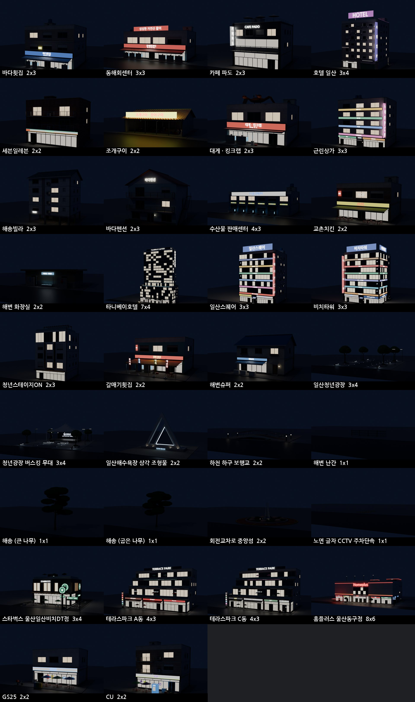

## 정교함 · 정확성 기준

모든 건물은 `designs.py` · `landmarks.py` · `plaza.py` 의 코드로 만들어지고, 만들 때마다 아래 검사를 통과해야 FBX 가 나옵니다
(`tests/test_designs.py`, `tests/test_geom.py` 로 블렌더 없이 확인).

- **문 · 창 · 간판 · 설비가 서로 겹치지 않음** — 파사드의 모든 요소가 벽 위 영역을 예약합니다.
  창 · 문은 다른 어떤 요소와도 벽면 투영이 겹치면 안 되고(차양 · 난간 · 수족관처럼 앞에 서 있는 것만 예외),
  나머지는 3차원으로 겹치면 안 됩니다. 자리가 없는 창 · 실외기는 옮기거나 생략하고, 층 띠 · 굽도리 · 가스관은
  창 · 간판을 피해 끊깁니다.
- **문을 가로지르는 창살 없음** — 상점 유리면의 멀리언은 문틀 사이 구간마다 따로 나누고, 문 높이는 가로대(transom)에 맞춥니다.
- **실제로 움푹 들어간 개구부** — 창 · 문 · 상점 유리 · 셔터 · 차고 입구는 벽에 구멍을 내고 15~40 cm 들어가 있습니다
  (양옆 · 위 · 아래 안쪽 면 + 안쪽 끝면). 미닫이 창은 앞뒤 두 줄 창틀, 창대는 밖으로 6 cm 돌출.
- **부지 밖으로 나가지 않음** — 옆벽 실외기처럼 이웃 부지에 닿을 수 있는 것은 자동으로 빠집니다.
- **옥상 설비 충돌 없음** — 난간 · 계단실 · 물탱크 · 실외기 · 간판 틀 · 조형물을 3차원으로 검사합니다.
- **면 방향** — CS2 는 뒷면을 그리지 않으므로 모든 닫힌 조각은 부호 있는 부피로 바깥을 향하게 맞추고,
  벽 · 개구부 안쪽 면은 방향을 계산해 만듭니다 (블렌더 법선 재계산을 쓰지 않음).
- **몸체가 여럿인 고층 건물** — 호텔처럼 저층부 위에 탑 · 코어가 서는 건물은 몸체마다 따로 예약하므로
  (`tower:front` 등) 다른 평면의 요소끼리 비교하지 않고, 몸체가 맞닿아 가려지는 벽 · 지붕은 만들지 않습니다.
- **커튼월** — 벽을 뚫은 개구부 하나 안에 층마다 스팬드럴 · 유리 · 멀리언 · 가로대, 필요하면 세로 핀과 층 차양까지 넣고
  칸마다 불 켜짐이 다릅니다. 핀 · 차양 깊이도 예약에 포함되어 간판 · 설비와 겹치지 않습니다.

---

## 1. 맵 만들기 (실측 지형)

광장 남쪽 하천은 하이트맵에 폭 약 8 m · 깊이 1.8 m 물길로 파여 있습니다. 하구는 해수면보다 낮아 바닷물이 들어오고,
상류에서 흘러내리게 하려면 물길 위쪽 끝(`Ilsan_Map.json` 의 `stream_xz` 두 번째 점)에 **강 수원**을 작게 두세요.

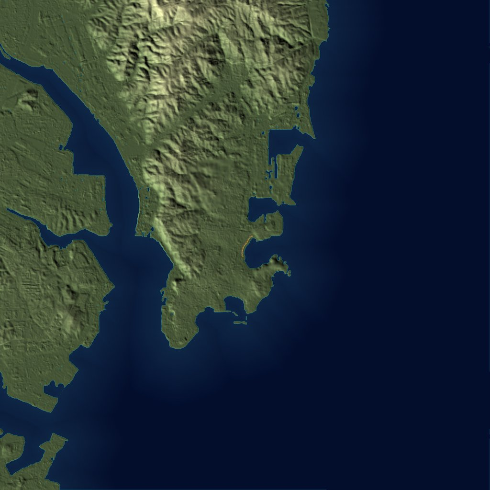

1. `Heightmaps/Ilsan_Heightmap.png`, `Ilsan_Worldmap.png` 를
   `%USERPROFILE%\AppData\LocalLow\Colossal Order\Cities Skylines II\Heightmaps\` 에 복사합니다.
2. 게임 메인 메뉴 → **에디터** → 새 맵 → 지형 패널에서 **하이트맵 가져오기**로 `Ilsan_Heightmap`,
   **월드맵 가져오기**로 `Ilsan_Worldmap` 을 고릅니다. 높이 배율은 기본값 **4096 m** 그대로 둡니다.
3. 바다 쪽 맵 가장자리에 **해수(Sea) 수원**을 놓고 수위를 **40 m** 로 맞춥니다
   (하이트맵은 해수면을 40 m 로 올려 해저 38 m 까지 표현합니다).
4. 맵 중심(0, 0)이 일산지 거리 한가운데, 북쪽이 위입니다.

| 항목 | 값 |
|---|---|
| 해상도 · 형식 | 4096 × 4096, 16-bit 회색조 PNG |
| 플레이 영역 | 14.336 km (3.5 m/px), 중심 35.4984° N, 129.4314° E |
| 월드맵 | 57.344 km (14 m/px), 가운데 1024 px = 플레이 영역 |
| 고도 | −38 m(해저) ~ 343 m (게임 높이 = 실제 고도 + 40 m) |

> **정확도:** 육지는 Copernicus GLO-30(30 m 격자) 실측 고도를 보간했습니다. 원본은 바다를 0 m 로 채우므로
> **해저 지형은 해안에서 1:45 로 깊어지게 추정**했습니다. 30 m 보다 작은 지형(옹벽 · 계단 등)은 없습니다.

## 2. 도로와 부지 위치

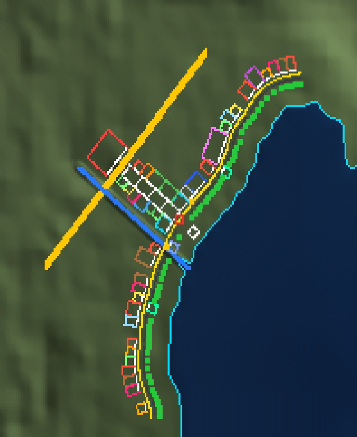

`Ilsan_Overlay.png` (하이트맵과 같은 4096² 투명 PNG):
- **청록** 실제 해안선 · **노랑** 해변 도로 중심선 → 게임에서 **소형 2차로 도로**를 이 선을 따라 그립니다
- **흰 선** 부지 앞선(도로 중심에서 8 m) · **색 사각형** 부지 (종류별 색)
- **빨간 원** 회전교차로 (지도 중심 0, 0) → 도로 도구의 **회전교차로**를 놓고 가운데에 `IlsanRoundabout` 를 얹습니다
- **파란 선** 하천 → 해변 도로가 건너는 곳은 **다리**로 바꿉니다 · **초록 점** 해송 · **진회색 선** 난간

정확한 숫자는 `Ilsan_Placement.md` (표)와 `Ilsan_Placement.json` (모드 · 스크립트용),
도로 중심선 5 m 간격 좌표 · 지면 높이는 `Ilsan_Map.json` 에 있습니다.

- 게임 좌표: 맵 중심 원점, **x = 동쪽, z = 북쪽** (m). 지면 높이는 하이트맵에서 직접 샘플
- 회전: 건물 정면(도로 쪽)이 향하는 방위, **북쪽 0° 에서 시계 방향**
- **해변 도로 상가 줄 29곳**: 고정 부지(타니베이호텔, 광장 모퉁이 유리 상가 2동, 하천 남쪽 스타벅스 울산일산비치DT점)를 먼저 놓고, 골목 · 광장 · 하천 자리를 비운 뒤
  나머지를 채웠습니다. 같은 건물이 나란히 서지 않고, 해변 곡선 때문에 부지 앞쪽에 작은 틈이 생기는 곳이 있습니다 (부지끼리는 겹치지 않음).
- **일산청년광장 14곳**: 회전교차로에서 육지 쪽으로 뻗은 폭 24 m · 길이 128 m 진입로를 광장 구간 4개(`IlsanPlaza01` ×3 + 끝의
  버스킹 무대 `IlsanPlazaStage`)로 채우고, 양옆 10곳은 **광장을 바라보는** 상가입니다 (`catalog.PLAZA_SIDES`, 북쪽에 테라스파크 A · C동).
- **방어진순환도로**: 광장 끝을 가로지르는 4차로 간선도로(폭 24 m, `Ilsan_Map.json` 의 `main_road`). 건너편 광장 축 끝에
  **홈플러스 울산동구점**이 광장 · 바다 쪽을 바라봅니다.
  광장 구간은 게임에서 공원 · 광장 부지로 넣고, 가운데 공유 차로를 **보행자 도로**로 이어도 됩니다.
- **바다 쪽 4곳**: 화장실 · 샤워장 2, 하천 보행교(산책로 위), 광장 축 끝 백사장의 삼각 조형물. 모두 도로(육지) 쪽을 바라봅니다.
- **소품 127개**: 해송은 호안 바로 바다 쪽 백사장(해안선에서 약 40 m)에 약 9 m 간격, 난간은 도로 바다 쪽 끝 산책로에
  8 m 토막으로 잇고 64 m 마다 해변으로 내려가는 틈을 둡니다. 노면 글자는 회전교차로 앞 양방향 차로에 있습니다.
  소품은 부지가 없으므로 게임에서 **소품(Prop) / 나무**로 가져와 좌표대로 놓습니다.

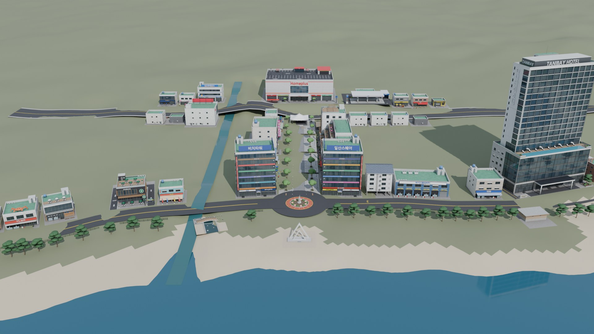

위 그림은 `preview_layout.py` 가 **하이트맵 + 배치표 + 내보낸 FBX 만으로** 다시 조립한 장면입니다
(도로 · 노란 중앙선 · 회전교차로 고리 · 하천 물은 미리보기용으로 함께 그립니다).

| 거리에서 (사진 ② 구도) | 밤 (Emissive 맵만으로 점등) |
|---|---|
|  | 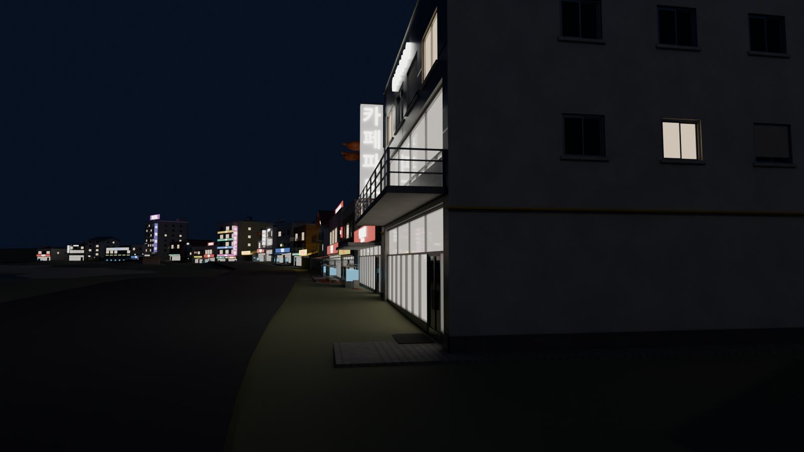 |

## 3. 에셋 가져오기

1. `CS2Assets` 폴더를 원하는 곳에 둡니다 (에셋마다 하위 폴더 하나).
2. 에디터 → **Asset Importer** → **Project Root** 를 `CS2Assets` 로 지정 → 에셋 폴더 선택 → 임포트.
3. 프리팹 설정에서 **부지 크기(셀)**를 위 표대로 맞추고 종류를 고릅니다. `<이름>.json` 의 `type` 이
   `building` 이면 건물, `plaza` 면 공원 · 광장(삼각 조형물 · 보행교 포함), `prop` 이면 부지 없는 소품
   (해송은 나무, 난간 · 회전교차로 중앙섬 · 노면 글자는 소품)입니다.

| 파일 | 내용 |
|---|---|
| `<이름>.fbx` | LOD0. 1 단위 = 1 m, 원점 = **부지 중심 지면**, 정면 = 블렌더 −Y (유니티 +Z) |
| `<이름>_LOD1.fbx`, `_LOD2.fbx` | LOD1: 작은 소품을 빼고 글자만 줄임 (건물 LOD0 의 39~77 %). LOD2: 글자 · 창틀 · 난간 · 실외기 · 수조를 빼고 같은 평면을 합침 (2~24 %). 작은 조각이 찌그러지지 않도록 건물 전체를 Collapse 하지 않습니다. 같은 UV 라 같은 텍스처를 씁니다 |
| `_BaseColor` | 기본색 + 약한 AO (sRGB) |
| `_Normal` | 탄젠트 공간, OpenGL(Y+). 타일 줄눈 · 사이딩 · 금속 이음매 범프 포함 |
| `_MaskMap` | R = 금속성, G = 코트(0), B = 0, A = 광택(1 − 거칠기) |
| `_ControlMask` | **R = 도장 벽**, **G = 차양 · 천막 · 파라솔 · 포인트색 · 금속 지붕** → 게임 색상 변형이 곱해집니다 |
| `_Emissive` | 간판 글자 · 간판 · 수족관 · 상점 유리 · 불 켜진 창 · 벽등 |
| `<이름>.json` | 부지 · 크기 · 높이 · 삼각형 수 · 개구부 수 |

> **확인이 필요한 점 (게임 버전에 따라 다를 수 있음)**
> - 정면 방향: 유니티 +Z. 게임에서 건물이 도로를 등지면 임포터에서 180° 돌리세요.
> - LOD 텍스처: LOD 파일은 메인 텍스처를 공유합니다. 임포터가 LOD 별 텍스처 이름을 요구하면
>   텍스처 5장을 `<이름>_LOD1_BaseColor.png` 처럼 복사하세요.
> - 부지 바닥판: 부지 전체에 얇은 포장 바닥(지면 위 3 cm)이 포함되어 있습니다.

## 4. 직접 다시 만들기 · 고치기

```bash
pip install numpy tifffile imagecodecs
python3 heightmap.py                                   # 하이트맵 · 오버레이 · 배치표

blender -b --python assets.py -- --preview previews     # 34종 전체 (블렌더 3.6+, 5.0.1 에서 확인)
blender -b --python assets.py -- --only IlsanCafe01 --tex 4096
blender -b --python preview_layout.py -- --render layout.png [--camera street] [--night]
blender -b --python preview_layout.py -- --photos docs [--only real_01,brand_02]   # 사진 6장 구도 + 브랜드 매장 4장

python3 -m unittest discover -s ../tests               # 겹침 · 부지 · 면 방향 검사 (블렌더 불필요)
```

- 건물 디자인 · 간판 문구 · 층수 · 색: `designs.py` (해변 상가 13종), `landmarks.py` (호텔 · 모퉁이 상가 · 청년스테이지 · 깃발 횟집 · 파란 지붕)
- 실제 브랜드 매장: `brands.py` (스타벅스 DT · 테라스파크 · 홈플러스 · GS25 · CU)
- 광장 · 해변 시설 · 소품: `plaza.py`, 조각(해송 · 가로수 · 무드 벤치 · 가로등 · 깃발 · 선베드 · 카페 테이블 · 카트 · 오토바이 …): `props.py`
- 재질: `materials.py` (패턴 · 거칠기 · 금속성 · 발광 · ControlMask 채널)
- 창 · 문 · 상점 · 셔터 · 커튼월 · 겹침 규칙: `geom.py`
- 부지 크기 · 거리 배치 순서 · 광장 양옆 상가 · 백사장 쪽 시설: `catalog.py`, 광장 · 하천 · 호텔 위치: `placement.py`

## 5. 무엇이 실제이고 무엇이 가상인가

| 실측 · 실제 정보 | 근사 · 가상 |
|---|---|
| 지형 고도, 해안선, 해변 곡선, 도로 위치 · 높이 | 해저 깊이 (추정) |
| 거리 길이 약 660 m, 골목 간격 (해안선 기준) | **해변 상가의 가게 이름 · 간판 · 디자인은 가상** — 실제 가게를 재현하지 않았습니다 |
| 타니베이호텔: 지상 19층 · 지하 2층, 147실 전 객실 바다 조망, 6층 인피니티 풀, 2층 레스토랑 '파도' | 호텔 외장 세부 (사진 한 장 기준의 해석), 호텔 위치 (광장 북쪽 약 150 m 로 근사) |
| 일산청년광장: 진입로 130 m 를 판석 광장으로, 가운데 화단 제거, 턱 낮춘 연석, 버스킹 공간, 무선 충전 무드 벤치 (2025년 7월 완공) | 광장 안 나무 · 벤치 · 무대 배치, 무대 천막 모양 |
| 청년스테이지ON: 5층 청년 공간 (해수욕장10길) | 외관 (사진이 없어 추정) |
| 해수욕장 가운데를 지나 바다로 나가는 하천 | 하천 정확한 위치 · 폭 (광장 남쪽 55 m 로 근사) |
| 테라스파크(방어진순환도로 652, 지상 4층 · 5개 동, 1층 카페 브랜드), 스타벅스 울산일산비치DT점(DT · 루프탑), 홈플러스 울산동구점(방어진순환도로 637) | 브랜드 매장 외관 세부 · 간판 모양(로고 대신 색 + 글자), 정확한 위치(광장 북쪽 · 하천 남쪽 · 광장 축 끝으로 근사), GS25 · CU 지점 위치 |
| | 회전교차로 모퉁이 유리 상가의 업종 · 이름, 백사장 흰 삼각 조형물 모양 (사진 기준 추정) |
| | 부지 순서 (`catalog.SEQUENCE`, `catalog.PLAZA_SIDES`) |

실제 가게 사진이나 이름을 주시면 간판과 외관을 그 건물에 맞춰 바꿀 수 있습니다.

## 데이터 · 규격 출처

- 고도: Copernicus DEM GLO-30 © DLR e.V. 2010-2014 and © Airbus Defence and Space GmbH 2014-2018,
  provided under COPERNICUS by the European Union and ESA (AWS Open Data `copernicus-dem-30m`)
- CS2 하이트맵 규격: Colossal Order 맵 에디터 개발 일지(4096², 16-bit, PNG/TIFF, 월드맵 가운데 1024² = 플레이 영역),
  Terraining Heightmap Generator 의 CS2 설정(57.344 km 월드, 높이 배율 4096)
- CS2 텍스처 접미사: Cities Skylines 2 Wiki · CSL Modding 문서
- 간판 폰트(미리보기 · 배포 에셋): 나눔고딕 (SIL Open Font License)
- 타니베이호텔 · 일산청년광장 · 청년스테이지ON 정보: 울산 동구청 · 언론 보도 (2023~2025) 검색 요약
- 테라스파크 (울산제일일보 분양 기사, 디스코 실거래 정보, 공차 · 봉구비어 매장 안내), 스타벅스 울산일산비치DT점 · 홈플러스 울산동구점
  (나무위키 스타벅스 울산 매장 목록, 다이닝코드 · 식신, 관광 정보 사이트) 검색 요약
