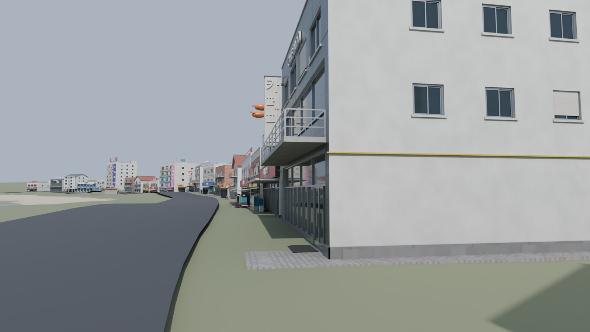

# 일산지 거리 — 시티즈: 스카이라인 2 인게임 배치 키트

울산 동구 **일산해수욕장 앞 해변 상가 거리**를 시티즈2 안에 옮기기 위한 키트입니다.

| 구성 | 위치 | 내용 |
|---|---|---|
| **실측 맵** | `Heightmaps/` | 일산지 거리를 중심으로 한 실제 지형 하이트맵(14.336 km)과 월드맵(57.344 km) |
| **건물 에셋 13종** | `CS2Assets/` | 해변 상가 · 숙박 · 주거 · 공공시설. 8 m 셀 부지 크기, 텍스처 5종, LOD 3단계 |
| **배치표** | `Heightmaps/Ilsan_Placement.md` | 실제 해변 곡선을 따라 놓은 36개 부지(상가 줄 34 + 백사장 쪽 2)의 게임 좌표 · 회전 · 높이 |


<!-- ASSET_TABLE -->
| 에셋 | 간판 | 종류 | 부지 (셀) | 건물 크기 | 높이 | 삼각형 LOD0 / 1 / 2 | 개구부 | 텍스처 |
|---|---|---|---|---|---|---|---|---|
| `IlsanHoetjip01` | 바다횟집 | 횟집 | 2×3 | 15.2 × 15.0 m | 15.35 m | 16,543 / 8,629 / 1,868 | 22 | 2048 |
| `IlsanHoetjip02` | 동해회센터 | 횟집 | 3×3 | 23.0 × 14.5 m | 11.15 m | 20,305 / 9,292 / 1,516 | 16 | 2048 |
| `IlsanCafe01` | 카페 파도 | 카페 | 2×3 | 14.0 × 14.0 m | 14.35 m | 12,300 / 7,744 / 1,984 | 25 | 2048 |
| `IlsanMotel01` | 호텔 일산 | 숙박 | 3×4 | 20.0 × 18.0 m | 28.2 m | 33,131 / 23,576 / 6,018 | 96 | 2048 |
| `IlsanShop01` | 편의점 | 상가 | 2×2 | 14.0 × 12.0 m | 12.95 m | 10,047 / 6,387 / 1,612 | 20 | 2048 |
| `IlsanGrill01` | 조개구이 | 조개구이 | 2×2 | 14.0 × 11.0 m | 5.7 m | 6,239 / 2,727 / 106 | 0 | 1024 |
| `IlsanCrab01` | 대게 · 킹크랩 | 대게 | 2×3 | 15.0 × 15.0 m | 11.06 m | 12,746 / 6,851 / 2,270 | 13 | 2048 |
| `IlsanMixed01` | 근린상가 | 근린상가 | 3×3 | 22.0 × 16.0 m | 23.15 m | 36,331 / 16,353 / 3,462 | 47 | 2048 |
| `IlsanVilla01` | 해송빌라 | 주거 | 2×3 | 14.0 × 13.0 m | 17.23 m | 10,955 / 8,446 / 2,350 | 40 | 2048 |
| `IlsanPension01` | 바다펜션 | 펜션 | 2×3 | 12.5 × 12.0 m | 12.83 m | 6,800 / 4,959 / 1,664 | 22 | 2048 |
| `IlsanMarket01` | 수산물 판매센터 | 시장 | 4×3 | 30.0 × 16.0 m | 13.65 m | 31,109 / 13,288 / 1,832 | 27 | 2048 |
| `IlsanChicken01` | 치킨 · 호프 | 치킨 | 2×2 | 13.5 × 10.5 m | 10.25 m | 15,396 / 6,540 / 1,370 | 13 | 2048 |
| `IlsanToilet01` | 해변 화장실 | 화장실 | 2×2 | 12.0 × 7.0 m | 4.0 m | 5,563 / 2,354 / 364 | 6 | 1024 |


## 정교함 · 정확성 기준

모든 건물은 `designs.py` 의 코드로 만들어지고, 만들 때마다 아래 검사를 통과해야 FBX 가 나옵니다
(`tests/test_designs.py`, `tests/test_geom.py` 로 블렌더 없이 확인).

- **문 · 창 · 간판 · 설비가 서로 겹치지 않음** — 파사드의 모든 요소가 벽 위 영역을 예약합니다.
  창 · 문은 다른 어떤 요소와도 벽면 투영이 겹치면 안 되고(차양 · 난간 · 수족관처럼 앞에 서 있는 것만 예외),
  나머지는 3차원으로 겹치면 안 됩니다. 자리가 없는 창 · 실외기는 옮기거나 생략하고, 층 띠 · 굽도리 · 가스관은
  창 · 간판을 피해 끊깁니다.
- **문을 가로지르는 창살 없음** — 상점 유리면의 멀리언은 문틀 사이 구간마다 따로 나누고, 문 높이는 가로대(transom)에 맞춥니다.
- **실제로 움푹 들어간 개구부** — 창 · 문 · 상점 유리 · 셔터 · 차고 입구는 벽에 구멍을 내고 15~40 cm 들어가 있습니다
  (양옆 · 위 · 아래 안쪽 면 + 안쪽 끝면). 미닫이 창은 앞뒤 두 줄 창틀, 창대는 밖으로 6 cm 돌출.
- **부지 밖으로 나가지 않음** — 옆벽 실외기처럼 이웃 부지에 닿을 수 있는 것은 자동으로 빠집니다.
- **옥상 설비 충돌 없음** — 난간 · 계단실 · 물탱크 · 실외기 · 간판 틀 · 조형물을 3차원으로 검사합니다.
- **면 방향** — CS2 는 뒷면을 그리지 않으므로 모든 닫힌 조각은 부호 있는 부피로 바깥을 향하게 맞추고,
  벽 · 개구부 안쪽 면은 방향을 계산해 만듭니다 (블렌더 법선 재계산을 쓰지 않음).

---

## 1. 맵 만들기 (실측 지형)


1. `Heightmaps/Ilsan_Heightmap.png`, `Ilsan_Worldmap.png` 를
   `%USERPROFILE%\AppData\LocalLow\Colossal Order\Cities Skylines II\Heightmaps\` 에 복사합니다.
2. 게임 메인 메뉴 → **에디터** → 새 맵 → 지형 패널에서 **하이트맵 가져오기**로 `Ilsan_Heightmap`,
   **월드맵 가져오기**로 `Ilsan_Worldmap` 을 고릅니다. 높이 배율은 기본값 **4096 m** 그대로 둡니다.
3. 바다 쪽 맵 가장자리에 **해수(Sea) 수원**을 놓고 수위를 **40 m** 로 맞춥니다
   (하이트맵은 해수면을 40 m 로 올려 해저 38 m 까지 표현합니다).
4. 맵 중심(0, 0)이 일산지 거리 한가운데, 북쪽이 위입니다.

| 항목 | 값 |
|---|---|
| 해상도 · 형식 | 4096 × 4096, 16-bit 회색조 PNG |
| 플레이 영역 | 14.336 km (3.5 m/px), 중심 35.4984° N, 129.4314° E |
| 월드맵 | 57.344 km (14 m/px), 가운데 1024 px = 플레이 영역 |
| 고도 | −38 m(해저) ~ 343 m (게임 높이 = 실제 고도 + 40 m) |

> **정확도:** 육지는 Copernicus GLO-30(30 m 격자) 실측 고도를 보간했습니다. 원본은 바다를 0 m 로 채우므로
> **해저 지형은 해안에서 1:45 로 깊어지게 추정**했습니다. 30 m 보다 작은 지형(옹벽 · 계단 등)은 없습니다.

## 2. 도로와 부지 위치


`Ilsan_Overlay.png` (하이트맵과 같은 4096² 투명 PNG):
- **청록** 실제 해안선 · **노랑** 해변 도로 중심선 → 게임에서 **소형 2차로 도로**를 이 선을 따라 그립니다
- **흰 선** 부지 앞선(도로 중심에서 8 m) · **색 사각형** 부지 (종류별 색)

정확한 숫자는 `Ilsan_Placement.md` (표)와 `Ilsan_Placement.json` (모드 · 스크립트용),
도로 중심선 5 m 간격 좌표 · 지면 높이는 `Ilsan_Map.json` 에 있습니다.

- 게임 좌표: 맵 중심 원점, **x = 동쪽, z = 북쪽** (m). 지면 높이는 하이트맵에서 직접 샘플
- 회전: 건물 정면(도로 쪽)이 향하는 방위, **북쪽 0° 에서 시계 방향**
- 상가 줄 34곳은 골목(해수욕장○길 같은 이면도로) 7곳을 비워 두고 배치했고, 같은 건물이 나란히 서지 않습니다.
  해변 곡선 때문에 부지 앞쪽에 작은 틈이 생기는 곳이 있습니다 (부지끼리는 겹치지 않음).
- 백사장 쪽 2곳(화장실 · 샤워장)은 도로 반대편에서 도로를 바라봅니다.


위 그림은 `preview_layout.py` 가 **하이트맵 + 배치표 + 내보낸 FBX 만으로** 다시 조립한 장면입니다.

| 거리에서 | 밤 (Emissive 맵만으로 점등) |
|---|---|
|  |  |

## 3. 에셋 가져오기

1. `CS2Assets` 폴더를 원하는 곳에 둡니다 (에셋마다 하위 폴더 하나).
2. 에디터 → **Asset Importer** → **Project Root** 를 `CS2Assets` 로 지정 → 에셋 폴더 선택 → 임포트.
3. 프리팹 설정에서 **부지 크기(셀)**를 위 표대로 맞추고 건물 종류를 고릅니다.

| 파일 | 내용 |
|---|---|
| `<이름>.fbx` | LOD0. 1 단위 = 1 m, 원점 = **부지 중심 지면**, 정면 = 블렌더 −Y (유니티 +Z) |
| `<이름>_LOD1.fbx`, `_LOD2.fbx` | LOD1: 작은 소품을 빼고 글자만 줄임 (LOD0 의 43~77 %). LOD2: 글자 · 창틀 · 난간 · 실외기 · 수조를 빼고 같은 평면을 합침 (2~18 %). 작은 조각이 찌그러지지 않도록 건물 전체를 Collapse 하지 않습니다. 같은 UV 라 같은 텍스처를 씁니다 |
| `_BaseColor` | 기본색 + 약한 AO (sRGB) |
| `_Normal` | 탄젠트 공간, OpenGL(Y+). 타일 줄눈 · 사이딩 · 금속 이음매 범프 포함 |
| `_MaskMap` | R = 금속성, G = 코트(0), B = 0, A = 광택(1 − 거칠기) |
| `_ControlMask` | **R = 도장 벽**, **G = 차양 · 천막 · 파라솔 · 포인트색 · 금속 지붕** → 게임 색상 변형이 곱해집니다 |
| `_Emissive` | 간판 글자 · 간판 · 수족관 · 상점 유리 · 불 켜진 창 · 벽등 |
| `<이름>.json` | 부지 · 크기 · 높이 · 삼각형 수 · 개구부 수 |

> **확인이 필요한 점 (게임 버전에 따라 다를 수 있음)**
> - 정면 방향: 유니티 +Z. 게임에서 건물이 도로를 등지면 임포터에서 180° 돌리세요.
> - LOD 텍스처: LOD 파일은 메인 텍스처를 공유합니다. 임포터가 LOD 별 텍스처 이름을 요구하면
>   텍스처 5장을 `<이름>_LOD1_BaseColor.png` 처럼 복사하세요.
> - 부지 바닥판: 부지 전체에 얇은 포장 바닥(지면 위 3 cm)이 포함되어 있습니다.

## 4. 직접 다시 만들기 · 고치기

```bash
pip install numpy tifffile imagecodecs
python3 heightmap.py                                   # 하이트맵 · 오버레이 · 배치표

blender -b --python assets.py -- --preview previews     # 13종 전체 (블렌더 3.6+, 5.0.1 에서 확인)
blender -b --python assets.py -- --only IlsanCafe01 --tex 4096
blender -b --python preview_layout.py -- --render layout.png [--camera street] [--night]

python3 -m unittest discover -s ../tests               # 겹침 · 부지 · 면 방향 검사 (블렌더 불필요)
```

- 건물 디자인 · 간판 문구 · 층수 · 색: `designs.py` (`hoetjip01` …)
- 재질: `materials.py` (패턴 · 거칠기 · 금속성 · 발광 · ControlMask 채널)
- 창 · 문 · 상점 · 셔터 · 겹침 규칙: `geom.py`
- 부지 크기 · 거리 배치 순서 · 백사장 쪽 시설: `catalog.py`

## 5. 무엇이 실제이고 무엇이 가상인가

| 실측 | 근사 · 가상 |
|---|---|
| 지형 고도, 해안선, 해변 곡선, 도로 위치 · 높이 | 해저 깊이 (추정) |
| 거리 길이 약 660 m, 골목 간격 (해안선 기준) | **가게 이름 · 간판 · 건물 디자인은 가상** — 실제 가게를 재현하지 않았습니다 |
| | 부지 순서 (`catalog.SEQUENCE`) |

실제 가게 사진이나 이름을 주시면 간판과 외관을 그 건물에 맞춰 바꿀 수 있습니다.

## 데이터 · 규격 출처

- 고도: Copernicus DEM GLO-30 © DLR e.V. 2010-2014 and © Airbus Defence and Space GmbH 2014-2018,
  provided under COPERNICUS by the European Union and ESA (AWS Open Data `copernicus-dem-30m`)
- CS2 하이트맵 규격: Colossal Order 맵 에디터 개발 일지(4096², 16-bit, PNG/TIFF, 월드맵 가운데 1024² = 플레이 영역),
  Terraining Heightmap Generator 의 CS2 설정(57.344 km 월드, 높이 배율 4096)
- CS2 텍스처 접미사: Cities Skylines 2 Wiki · CSL Modding 문서
- 간판 폰트(미리보기 · 배포 에셋): 나눔고딕 (SIL Open Font License)
