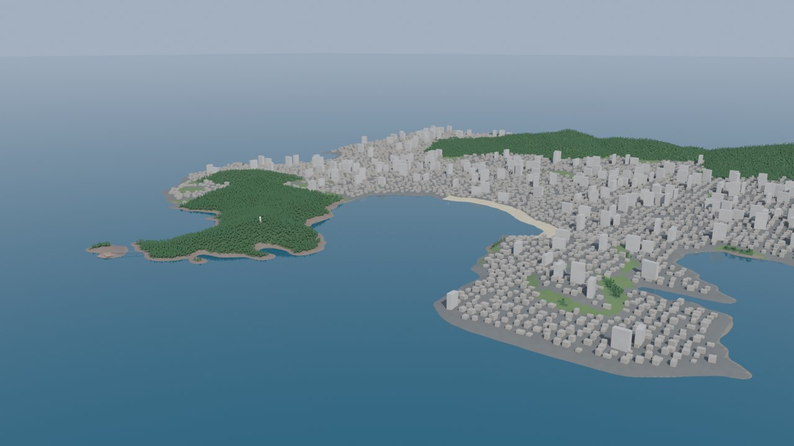
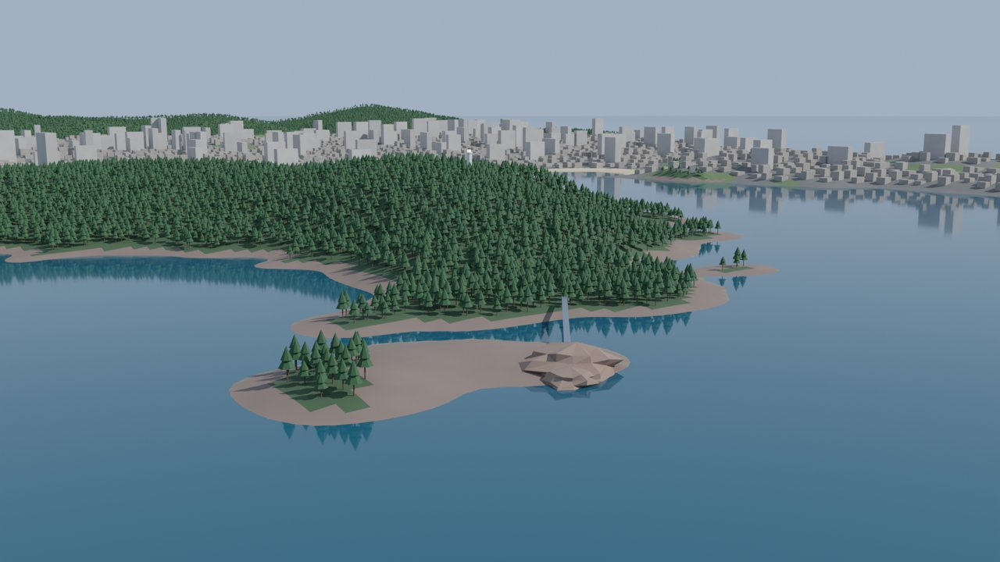

# 울산 동구 일산동 — 블렌더 장면

**일산해수욕장 · 대왕암공원 · 울기등대 · 대왕교** 일대(약 3.6 km × 2.7 km)를
**실제 위성 고도 데이터(Copernicus DEM, 30 m)** 로 만든 블렌더 장면입니다.




## 실행

블렌더 3.6 이상 (5.0.1 에서 실제로 생성·렌더 확인).

**블렌더 UI에서:** Scripting 탭 → `build_ilsan.py` 열기 → **Run Script**
(`terrain.py`, `data/` 가 같은 폴더에 있어야 합니다)

**명령줄에서:**
```bash
blender --python build_ilsan.py                                    # 장면 열기
blender -b --python build_ilsan.py -- --save ilsan.blend           # .blend 저장
blender -b --python build_ilsan.py -- --engine cycles --render out.png
blender -b --python build_ilsan.py -- --camera 카메라_대왕암 --engine cycles --render daewangam.png
```

| 옵션 | 설명 |
|---|---|
| `--upsample N` | 30 m DEM 을 N배 보간 (기본 3 → 약 9 m 격자, 11만 정점) |
| `--exaggeration F` | 고도 과장 (예: 2.0 이면 언덕이 2배 높게) |
| `--no-buildings` / `--no-trees` | 가상 건물 / 나무 생략 (가벼운 장면) |
| `--engine cycles\|eevee`, `--samples N` | 렌더 엔진과 샘플 수 |
| `--camera 카메라\|카메라_대왕암` | 전경 / 대왕암 근경 |

다시 실행하면 `일산동` 컬렉션만 지우고 새로 만듭니다.

## 장면 구성 (`일산동` 컬렉션)

| 항목 | 데이터 | 정확도 |
|---|---|---|
| **지형** | Copernicus GLO-30 DEM 실측 고도. 해안선은 고도 0 m 경계 | ✅ 실제 (30 m 해상도) |
| **바다·해저** | 해수면 0 m 평면, 해저는 해안에서 멀수록 최대 25 m 깊어지도록 생성 | ⚠️ 해저 깊이는 임의 |
| **모래사장** | 일산해수욕장 범위 안의 해안 저지대 | 🔶 범위 근사 |
| **송림** | 대왕암공원 반도에 곰솔(해송) 약 4천 그루 | 🔶 범위 근사, 개별 나무는 무작위 |
| **산림** | 고도 45 m 이상·급경사 지역 | 🔶 지형 기반 추정 |
| **울기등대** | 흰색 팔각 등탑(약 24 m), 공원 언덕 위 | 🔶 위치 근사, 형태 단순화 |
| **대왕암·대왕교** | 화강암 바위섬과 철교 | 🔶 위치 근사, 형태 단순화 |
| **건물** | `건물 (가상 배치)` — 시가지 지형에 절차적으로 배치한 상자 | ❌ 실제 건물 아님 |

> 건물·도로는 OpenStreetMap 에서 가져오는 것이 정석이지만, 이 작업 환경에서는 OSM 서버에
> 접속할 수 없어 분위기용 가상 배치로 대신했습니다. `표시_*` 빈 오브젝트로 랜드마크 위치를 찾을 수 있습니다.

## 파일

- `build_ilsan.py` — 블렌더 장면 생성 (메시·머티리얼·나무 인스턴싱·카메라·조명)
- `terrain.py` — 블렌더 비의존 지형 처리 (좌표 변환, 보간, 해저, 토지 피복 분류, 배치)
- `fetch_dem.py` — DEM 다시 받기 (`pip install numpy tifffile imagecodecs`). 영역은 `BBOX` 에서 수정
- `data/ilsan_dem.npy`, `data/ilsan_dem.json` — 잘라 둔 고도 데이터 (90 × 144, 위경도 범위 포함)

## 더 실제처럼 만들려면

- **건물·도로:** [BlenderGIS](https://github.com/domlysz/BlenderGIS) 애드온의 *Get OSM* 으로 같은 영역의 건물을
  받아 `건물 (가상 배치)` 컬렉션을 끄고 대신 쓰면 실제 배치가 됩니다. 이 장면은 영역 중심
  (35.4955 N, 129.4319 E)을 원점으로 하는 미터 좌표라, BlenderGIS 의 원점과 맞추면 겹쳐집니다.
- **항공사진:** 국토지리정보원 정사영상 등을 지형 UV(위에서 투영)로 입히면 색이 실제와 같아집니다.
- **시티즈2 에셋:** 울기등대처럼 개별 랜드마크는 상위 폴더의 `cs2_asset_tools` 애드온으로
  LOD·텍스처를 갖춰 CS2 에셋으로 내보낼 수 있습니다.

## 데이터 출처

Copernicus DEM GLO-30 © DLR e.V. 2010-2014 and © Airbus Defence and Space GmbH 2014-2018
provided under COPERNICUS by the European Union and ESA. (AWS Open Data `copernicus-dem-30m`)
